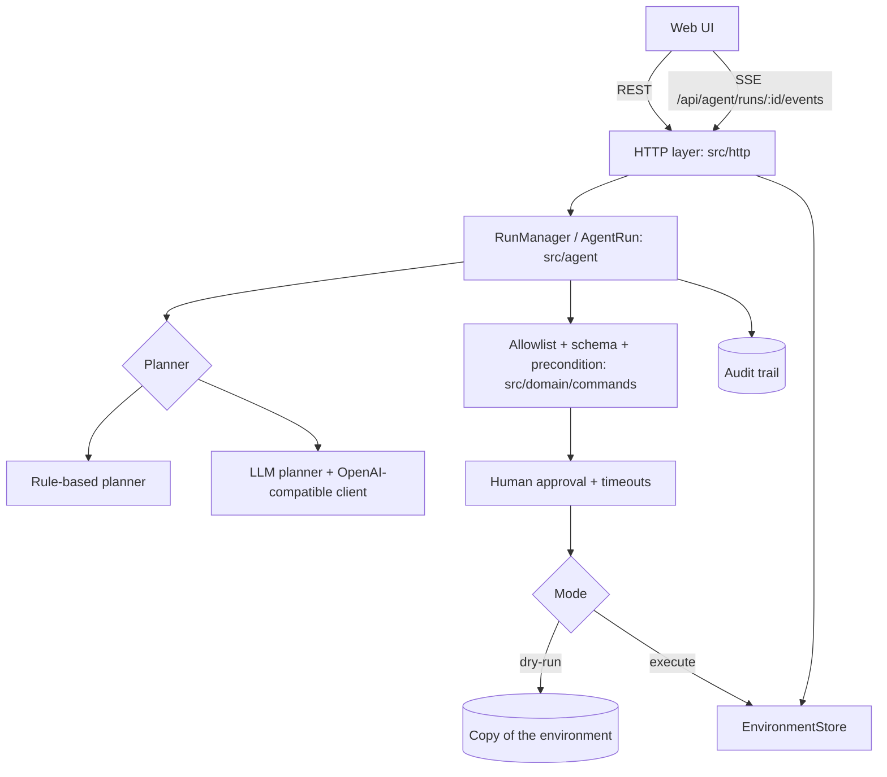

# AutoSRE Agent

[](https://github.com/codebyjuliamendes/ai-autosre-agent/actions/workflows/ci-cd.yml)
[](https://nodejs.org/)
[](LICENSE)

AutoSRE is a **simulator of an SRE agent** that diagnoses and fixes a server incident with a
ReAct loop (reason, act, observe). You can watch it think, approve or reject what it wants to
do, and see what happens to the (simulated) server.

The focus is on the **guardrails** an agent that touches infrastructure needs: an allowlist of
tools, dry-run by default, human approval for destructive actions, timeouts everywhere and an
audit trail.

> **What this is, and what it is not.** The "server" is an in-memory model (processes, services,
> logs). No real commands run on any machine. By default the agent is a **deterministic,
> rule-based planner**. You can switch on an **optional LLM planner** (any OpenAI-compatible API).
> It goes through the same gates.

## Features

- **Chaos scenario**: a crypto-miner eats the CPU and PostgreSQL goes down, so nginx returns 500.
- **ReAct agent** streamed live over Server-Sent Events (thoughts, actions, observations).
- **Allowlisted tools only**: `verify_health`, `read_log`, `list_processes`, `list_services`,
  `kill_process`, `restart_service`. Commands are data (`{ tool, args }`), never strings that get
  evaluated. Each one is checked against a strict schema and a precondition. Protected processes
  (PID 1, `init`...) can never be killed.
- **Dry-run by default**: commands run against a copy of the environment. Use `execute` mode
  to change the simulated environment. You can turn execute mode off for the whole server.
- **Human-in-the-loop**: destructive tools always need approval. Set `AGENT_APPROVAL_POLICY=all`
  to approve every command. If nobody decides before the approval timeout, the action is rejected.
- **Timeouts and limits**: planner (LLM) timeout, per-command timeout, approval timeout, whole-run
  timeout, and a maximum number of steps.
- **Audit trail**: every proposal, approval, rejection, timeout and execution is recorded. You
  can read it at `GET /api/audit`, it goes to the structured logs, and it can also be appended
  to a JSON Lines file.
- **Operator token** (optional) for write endpoints, approvals and the audit trail. Write
  endpoints are rate-limited.
- Web UI with no third-party scripts (strict CSP), dark/light theme, keyboard-accessible, responsive.
- OpenAPI docs at `/api-docs` (Swagger UI served locally).

## Quick start

```bash
npm ci
npm start            # http://localhost:4002
```

1. Click **Trigger chaos**: CPU goes to 99% and the status to 500.
2. Choose **Dry-run** or **Execute** and click **Run agent**.
3. Approve or reject `kill_process(1337)` and `restart_service("postgres")` when asked.

With Docker:

```bash
cp .env.example .env   # optional, adjust values
docker compose up --build
```

## Configuration

All configuration comes from environment variables. It is validated at boot, and the server
refuses to start with invalid values. See [`.env.example`](.env.example).

| Variable                    | Default                     | Description                                                     |
| --------------------------- | --------------------------- | --------------------------------------------------------------- |
| `PORT` / `HOST`             | `4002` / `0.0.0.0`          | HTTP bind                                                       |
| `LOG_LEVEL`                 | `info`                      | pino level (`silent` to disable)                                |
| `TRUST_PROXY`               | `false`                     | Express `trust proxy` (set `1` behind an ingress/reverse proxy) |
| `CORS_ORIGINS`              | _(empty: same-origin only)_ | Comma separated allowed origins                                 |
| `OPERATOR_TOKEN`            | _(unset: open)_             | Bearer token (min. 16 chars) for writes, approvals and audit    |
| `RATE_LIMIT_WINDOW_MS/MAX`  | `60000` / `30`              | Rate limit for write endpoints, per IP                          |
| `AGENT_DEFAULT_MODE`        | `dry-run`                   | `dry-run` or `execute`                                          |
| `AGENT_ALLOW_EXECUTE`       | `true`                      | `false` disables execute mode                                   |
| `AGENT_APPROVAL_POLICY`     | `destructive`               | `destructive` or `all`                                          |
| `AGENT_MAX_STEPS`           | `12`                        | Hard limit of steps per run                                     |
| `AGENT_STEP_DELAY_MS`       | `400`                       | Pause between steps so a human can follow the stream            |
| `AGENT_PLANNER_TIMEOUT_MS`  | `20000`                     | Timeout for each planning step                                  |
| `AGENT_COMMAND_TIMEOUT_MS`  | `5000`                      | Timeout for each command                                        |
| `AGENT_APPROVAL_TIMEOUT_MS` | `120000`                    | No decision in time = rejection                                 |
| `AGENT_RUN_TIMEOUT_MS`      | `600000`                    | Timeout for the whole run                                       |
| `AUDIT_LOG_FILE`            | _(unset)_                   | Append the audit trail as JSON Lines to this file               |
| `LLM_PROVIDER`              | `none`                      | `none` (rule-based) or `openai-compatible`                      |
| `LLM_BASE_URL`              | `https://api.openai.com/v1` | Any OpenAI-compatible endpoint (Ollama, vLLM, OpenRouter...)    |
| `LLM_API_KEY`               | _(unset)_                   | API key, if the endpoint needs one                              |
| `LLM_MODEL`                 | `gpt-4o-mini`               | Model name                                                      |
| `LLM_TIMEOUT_MS`            | `15000`                     | HTTP timeout for the LLM call                                   |

> Without `OPERATOR_TOKEN` anyone who can reach the server can inject chaos and approve actions.
> That is fine on your own machine. Set a token anywhere else (the server logs a warning).

## Scripts

| Script                  | What it does                               |
| ----------------------- | ------------------------------------------ |
| `npm start`             | Start the server                           |
| `npm run dev`           | Start with `--watch`                       |
| `npm test`              | Unit and integration tests (`node:test`)   |
| `npm run test:coverage` | Tests with coverage                        |
| `npm run lint`          | ESLint                                     |
| `npm run format`        | Prettier (write); `format:check` to verify |
| `npm run typecheck`     | TypeScript `checkJs` over the JSDoc types  |
| `npm run check`         | lint + format check + typecheck + tests    |

## Architecture



```
server.js                 entry point (kept for existing deploys)
src/main.js               composition root, boot, graceful shutdown
src/config.js             env validation (zod)
src/domain/               pure rules: environment model, tool allowlist, rule-based planner
src/agent/                AgentRun (ReAct loop + gates) and RunManager (one active run)
src/llm/                  optional LLM planner and HTTP client
src/audit/                audit trail
src/http/                 Express app, middleware (auth, errors), routes
public/                   static UI, OpenAPI spec
test/unit, test/integration
```

Design decisions:

- **Domain logic is pure.** State transitions return new objects, which makes dry-run trivial
  (the run works on a clone) and keeps the rules easy to unit test.
- **The planner only proposes.** Rule-based or LLM, its output is validated before anything
  happens. If an LLM proposes something outside the allowlist, the run stops before the action
  reaches a human. Observations are passed to the LLM as untrusted data.
- **A run is a resource.** `POST /api/agent/runs` starts it. `GET .../events` streams it, and
  you can replay or resume the stream with `Last-Event-ID`. Approvals are tied to a run and an
  action id. Only one run is active at a time, because there is a single environment.
- **SSE instead of WebSockets.** The stream only goes from server to client, and decisions go
  over REST. Compression is disabled for the stream, and heartbeats keep proxies from closing it.
- **Health and lifecycle**: `/healthz` (liveness) and `/readyz` (readiness, 503 while draining).
  On SIGTERM the server stops accepting work, cancels the active run, closes streams and exits.

## API

See `/api-docs` for the full OpenAPI spec. Main endpoints:

| Method | Path                          | Notes                                           |
| ------ | ----------------------------- | ----------------------------------------------- |
| GET    | `/api/state`                  | Current environment                             |
| POST   | `/api/chaos`, `/api/reset`    | Change environment (cancels active run)         |
| POST   | `/api/agent/runs`             | `{ "mode": "dry-run" \| "execute" }`            |
| GET    | `/api/agent/runs/:id/events`  | SSE stream                                      |
| POST   | `/api/agent/runs/:id/approve` | `{ "actionId", "approved": bool, "operator"? }` |
| POST   | `/api/agent/runs/:id/cancel`  | Cancel a run                                    |
| GET    | `/api/audit`                  | `?limit=&runId=`                                |

## Tests

```bash
npm run check
```

- **Unit tests** cover the environment rules, the allowlist (including injection attempts such
  as `__proto__` or unknown tools), the rule-based planner (end-to-end on the chaos scenario),
  the LLM planner and HTTP client with a **mocked LLM** (no network), config validation, the
  audit trail, and the run state machine (dry-run, approvals, rejection, approval timeout,
  planner timeout, step limit, cancellation).
- **Integration tests** (supertest and a real HTTP server for SSE) cover the API, auth, validation,
  rate limiting, security headers, SSE streaming with approvals and resuming with `Last-Event-ID`.

## Deploy

- **Docker**: multi-stage image, runs as a non-root user, has a `HEALTHCHECK`, works with a
  read-only filesystem.
- **Kubernetes** (`k8s/`): single replica (the state is in memory), hardened
  `securityContext`, startup, readiness and liveness probes, operator token read from a Secret
  (`k8s/secret.example.yaml`), and an nginx ingress set up for SSE.
- **CI** (GitHub Actions): lint, format, typecheck, tests on Node 22 and 24, `npm audit`, Docker
  build and smoke test. Dependabot covers npm, Docker and Actions.

## Limitations

- The environment and all runs are **in memory**. A restart resets them, and the app cannot
  scale horizontally as is. A real deployment would need shared storage for state, runs and
  pending approvals.
- The operator token is a single shared secret. There are no user accounts. The `operator`
  name in the audit trail is whatever the client sends.
- The LLM planner has been tested against a mocked model only. How good its plans are depends
  on the model you configure.
- The tools act on the simulation only. Connecting them to real infrastructure would need real
  executors behind the same allowlist and approval gates, plus proper authentication and
  authorization.

## License

[MIT](LICENSE)
